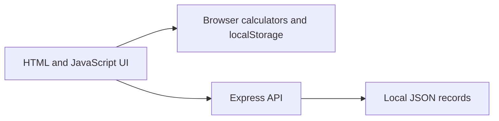

# FinLit — Financial Literacy Platform

## Overview and problem statement

FinLit is an educational web application designed to help users explore digital financial literacy, inclusion, budgeting, loans and savings. It combines educational resources, interactive calculators, assessments, account-related pages and a lightweight Express API.

> **Security status: local demonstration only.** The repair branch hardens the Express API, but browser-local authentication is still demonstration code and existing data may contain legacy plaintext credentials. Do not deploy publicly or enter real credentials or personal information.

## Features

- Budget, savings and loan calculator pages with interactive charts.
- Financial education and digital/financial/inclusion assessment workflows.
- Client-side demonstration account state using localStorage.
- Express API and file-backed storage for user and calculation records.

## Technology stack

| Dependency | Manifest range | Resolved npm lock version |
| --- | --- | --- |
| Express | ^4.18.2 | 4.22.2 |
| cors | ^2.8.5 | 2.8.6 |
| body-parser | ^1.20.2 | 1.20.5 |
| nodemon (development) | ^2.0.22 | 2.0.22 |

HTML, CSS and browser JavaScript implement the frontend. The home page uses Chart.js (both an unversioned CDN reference and 3.9.1), chartjs-plugin-datalabels 2.0.0, GSAP 3.11.4, Font Awesome 6.4.0 and Google Fonts. Other pages use differing CDN versions. See [package.json](package.json) and [package-lock.json](package-lock.json).

## Architecture and structure



- [FINLIT.html](FINLIT.html) — home page.
- [CALCULATORS/](CALCULATORS/) — budget, savings and loan tools.
- [information.html](information.html), [account.html](account.html) — educational and account pages.
- [css/](css/), [js/](js/), [images/](images/) — frontend assets.
- [server.js](server.js) — Express server and API.
- `data/` — JSON-backed storage (not a production database).
- [FinLit2025_Diagrams.md](FinLit2025_Diagrams.md) — design diagrams; planned entities do not necessarily correspond to implemented storage.
- [vercel.json](vercel.json) — deployment configuration (not a verified deployment).

## Prerequisites and setup

Install a supported Node.js LTS release and npm; no exact Node version is pinned. A modern browser and internet access for CDN resources are required. Run only in a private local environment with synthetic data.

```bash
git clone https://github.com/Rmadanmohamed/FinLit.git
cd FinLit
npm ci
npm start
```

Visit http://localhost:3000. The manifest also includes `npm run dev` (nodemon) and `npm run build` (a no-op message; there is no compilation step).

## Environment variables

| Variable | Required | Purpose / safe value |
| --- | --- | --- |
| PORT | No | Local HTTP port; defaults to `3000` |
| NODE_ENV | No | Use `development` or leave unset for local startup; `production` disables the listener |
| VERCEL | No | Platform flag; leave unset locally. If present, storage moves to `/tmp/data` and the standalone listener is skipped |

No secrets are necessary for local demonstration. The application stores JSON on disk and has no database initialization step. Avoid using or distributing personal data.

## Usage and API

Open the home page and choose [Budget](CALCULATORS/budget.html), [Savings](CALCULATORS/savings.html) or [Loan](CALCULATORS/loan.html). Enter fictional values to explore estimates; outputs are educational, not personalized financial advice. Assessment code generates scores and recommendations from form responses.

The server defines the following routes: registration/login (POST), user listing (GET), calculation save (POST), user calculation retrieval (GET), and calculation deletion (DELETE). Registration/login return a short-lived bearer token. Calculation routes enforce the authenticated user's ownership; the user-listing route is disabled. These endpoints are still not production-ready. Frontend localStorage state and server records should not be assumed to be securely synchronized.

## Testing and validation

An API regression suite is included: `node --test tests/api-security.test.js` (Node.js 20+ and installed dependencies). It uses temporary synthetic data. For local testing, use synthetic inputs to check calculator boundary values, page navigation, and assessment output. Add authorization, input validation and calculation unit tests before deployment. No build, test or deployment was executed during this audit.

## Screenshots and demo

No verified public demo or standalone interface screenshot was identified. The committed financial charts are illustrative content; the [design diagrams](FinLit2025_Diagrams.md) are available as documentation.

## Limitations and next steps

1. Finish the migration/reset strategy for inactive legacy accounts and replace browser-local authentication. The API uses salted scrypt hashes for new accounts and upgrades a legacy password on successful login.
2. Use persistent server-side sessions and wire the browser UI to the authenticated API; the repair branch currently uses process-local sessions.
3. Restrict CORS, validate inputs, rate-limit requests and prevent exposure of data files through static serving.
4. Replace local JSON persistence with a managed database; serverless temporary storage is not durable.
5. Verify calculator formulas and browser accessibility before release.

No trained ML model or dataset evaluation applies.

## Attribution and license

The manifest credits the **FinLit2025 Team**. Preserve original authorship and contributor history. The package manifest declares MIT, but a standalone license file was not found in this repository; verify licensing before redistribution.

Portfolio contact: [Ramadan Mohamed Hassan](https://ramadan-ai-portfolio.vercel.app/) · [LinkedIn](https://www.linkedin.com/in/ramadan-mohamed-89085a366/) · [GitHub](https://github.com/Rmadanmohamed)

## Repair-branch API configuration

Optional `FINLIT_DATA_DIR` points to a private writable directory outside public assets. Existing storage is not bulk-migrated or deleted. API registration requires a minimum 12-character password. Send the returned token as `Authorization: Bearer YOUR_SESSION_TOKEN` to calculation endpoints and POST /api/users/logout. Tokens expire after one hour and are lost on restart; this single-process demonstration design is unsuitable for distributed/serverless deployment. The browser demo does not yet use these sessions. Do not enter real credentials. Existing tracked data/history must be reviewed separately; no data files were modified.
