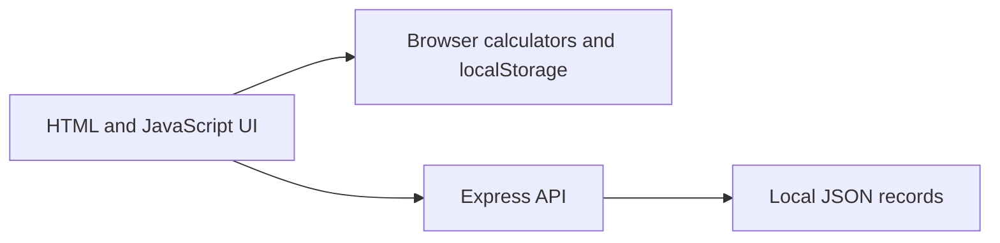

# FinLit — Financial Literacy Platform

> **Security remediation branch — not production-certified.** Registration and login use the Express API, salted scrypt hashes and opaque, expiring, revocable sessions. The browser receives an HttpOnly, SameSite=Strict cookie (Secure in production); non-browser clients may receive a bearer token. Account history is read from authenticated endpoints. No browser password store is used. Legacy browser records are not imported or deleted automatically. The public user directory is restricted because there is no authorized administrative role. Historical credentials in Git history must still be considered exposed and rotated by their owners. Do not deploy this branch until its integration, browser and security gates pass.

### Local secure setup

Run `npm ci` and `npm start` using Node.js 22 or a supported compatible release. Open the app through the Express origin rather than file://. The local single-process server uses ignored `.finlit-data/` by default; optionally set `FINLIT_DATA_DIR` to a private persistent directory outside the public tree. Existing file-backed accounts can be pointed to explicitly after backing them up; their legacy passwords are upgraded only upon successful login. Never use the tracked empty fixtures as a live database. Opaque session hashes and records are stored privately; writes are atomic for a single process. Vercel/serverless account API requests fail closed because temporary storage is not durable. A managed/shared data store and distributed rate limiter are required for multi-instance deployment; production HTTPS is mandatory. No actual account records were migrated.

For browser requests, the frontend uses `X-FinLit-Client: browser` and same-origin cookies. For API clients use `Authorization: Bearer <token>`. Session duration is one hour; logout revokes the current token. Run `node --test tests/security.test.js` for the isolated synthetic API integration tests.

The following description is historical context from the baseline audit; use the repaired setup and API notes above where they differ.

## Overview and problem statement

FinLit is an educational web application designed to help users explore digital financial literacy, inclusion, budgeting, loans and savings. It combines educational resources, interactive calculators, assessments, account-related pages and a lightweight Express API.

> **Security status: local demonstration only.** The server stores passwords in plaintext JSON and provides user/calculation endpoints without authentication or authorization. Do not deploy publicly or enter real credentials, financial records or personal information. The source has not been changed as part of this documentation update.

## Features

- Budget, savings and loan calculator pages with interactive charts.
- Financial education and digital/financial/inclusion assessment workflows.
- Client-side demonstration account state using localStorage.
- Express API and file-backed storage for user and calculation records.

## Technology stack

| Dependency | Manifest range | Resolved npm lock version |
| --- | --- | --- |
| Express | ^4.18.2 | 4.22.2 |
| cors | ^2.8.5 | 2.8.6 |
| body-parser | ^1.20.2 | 1.20.5 |
| nodemon (development) | ^2.0.22 | 2.0.22 |

HTML, CSS and browser JavaScript implement the frontend. The home page uses Chart.js (both an unversioned CDN reference and 3.9.1), chartjs-plugin-datalabels 2.0.0, GSAP 3.11.4, Font Awesome 6.4.0 and Google Fonts. Other pages use differing CDN versions. See [package.json](package.json) and [package-lock.json](package-lock.json).

## Architecture and structure



- [FINLIT.html](FINLIT.html) — home page.
- [CALCULATORS/](CALCULATORS/) — budget, savings and loan tools.
- [information.html](information.html), [account.html](account.html) — educational and account pages.
- [css/](css/), [js/](js/), [images/](images/) — frontend assets.
- [server.js](server.js) — Express server and API.
- `data/` — JSON-backed storage (not a production database).
- [FinLit2025_Diagrams.md](FinLit2025_Diagrams.md) — design diagrams; planned entities do not necessarily correspond to implemented storage.
- [vercel.json](vercel.json) — deployment configuration (not a verified deployment).

## Prerequisites and setup

Install a supported Node.js LTS release and npm; no exact Node version is pinned. A modern browser and internet access for CDN resources are required. Run only in a private local environment with synthetic data.

```bash
git clone https://github.com/Rmadanmohamed/FinLit.git
cd FinLit
npm ci
npm start
```

Visit http://localhost:3000. The manifest also includes `npm run dev` (nodemon) and `npm run build` (a no-op message; there is no compilation step).

## Environment variables

| Variable | Required | Purpose / safe value |
| --- | --- | --- |
| PORT | No | Local HTTP port; defaults to `3000` |
| NODE_ENV | No | Use `development` or leave unset for local startup; `production` disables the listener |
| VERCEL | No | Platform flag; leave unset locally. If present, storage moves to `/tmp/data` and the standalone listener is skipped |

No secrets are necessary for local demonstration. The application stores JSON on disk and has no database initialization step. Avoid using or distributing personal data.

## Usage and API

Open the home page and choose [Budget](CALCULATORS/budget.html), [Savings](CALCULATORS/savings.html) or [Loan](CALCULATORS/loan.html). Enter fictional values to explore estimates; outputs are educational, not personalized financial advice. Assessment code generates scores and recommendations from form responses.

The server defines the following routes: registration/login (POST), user listing (GET), calculation save (POST), user calculation retrieval (GET), and calculation deletion (DELETE). These endpoints lack production-safe access controls and must not be exposed publicly. Frontend localStorage state and server records should not be assumed to be securely synchronized.

## Testing and validation

No automated test suite is included. For local testing, use synthetic inputs to check calculator boundary values, page navigation, and assessment output. Add authorization, input validation and calculation unit tests before deployment. No build, test or deployment was executed during this audit.

## Screenshots and demo

No verified public demo or standalone interface screenshot was identified. The committed financial charts are illustrative content; the [design diagrams](FinLit2025_Diagrams.md) are available as documentation.

## Limitations and next steps

1. Replace plaintext password storage with secure password hashing and an appropriate migration/reset strategy.
2. Require authenticated sessions and enforce ownership checks on all user and calculation operations.
3. Restrict CORS, validate inputs, rate-limit requests and prevent exposure of data files through static serving.
4. Replace local JSON persistence with a managed database; serverless temporary storage is not durable.
5. Verify calculator formulas and browser accessibility before release.

No trained ML model or dataset evaluation applies.

## Attribution and license

The manifest credits the **FinLit2025 Team**. Preserve original authorship and contributor history. The package manifest declares MIT, but a standalone license file was not found in this repository; verify licensing before redistribution.

Portfolio contact: [Ramadan Mohamed Hassan](https://ramadan-ai-portfolio.vercel.app/) · [LinkedIn](https://www.linkedin.com/in/ramadan-mohamed-89085a366/) · [GitHub](https://github.com/Rmadanmohamed)
